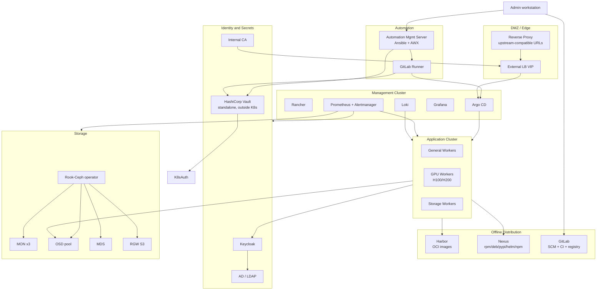

# Cloud-Native Stack Reference Architecture

This document defines the canonical reference architecture for the Cloud-Native Stack.

## Overview

The architecture follows a layered model with clear separation between management and application planes.

## Layers

| Layer | Components | Failure Impact |
|---|---|---|
| Physical | Servers, PDUs, switches | Node loss; storage designed to tolerate |
| Offline Distribution | Harbor, Nexus, RPM/DEB mirrors, GitLab | New deployments blocked; running workloads unaffected |
| Automation | Automation Management Server, Ansible, AWX, GitLab Runner | Changes blocked; workloads unaffected |
| Identity & Secrets | Keycloak, SSSD/AD, Vault, internal CA | Login blocked; workloads keep running |
| Storage | Ceph MON/MGR/OSD/MDS/RGW, Rook operator | PVC IO blocks; pod restart loop |
| Kubernetes | Control plane, etcd, CNI, CSI | Scheduling/API blocked; running pods keep IP |
| GitOps | Argo CD, GitLab | New/changed deploys blocked; no auto-revert |
| Management | Rancher, Prometheus, Grafana, Loki | Visibility lost; no data plane impact |

## Control / Data Plane Split

- **Management Cluster** — Rancher, Argo CD, Keycloak, Prometheus/Grafana, GitLab runner. Dedicated infrastructure worker pool, no application workloads.
- **Application Clusters** — general workers, GPU workers, storage-facing workers. No Rancher, no Vault server, no GitLab.

Rationale: `decisions/ADR-0010.md`, `decisions/ADR-0013.md`, `decisions/ADR-0025.md`.

## Networking

| Segment | Purpose | Typical CIDR (PROVISIONAL) |
|---|---|---|
| mgmt | SSH, Ansible, monitoring, GitLab, registry, Vault, identity | 10.10.0.0/24 |
| control-plane | kube-apiserver, etcd peer/client, CNI control | 10.20.0.0/24 |
| pod | pod CIDR per cluster (Cilium native routing) | 10.30.0.0/16, 10.31.0.0/16 |
| service | ClusterIP range | 10.32.0.0/16, 10.33.0.0/16 |
| storage | Ceph public + cluster networks | 10.40.0.0/24 + 10.41.0.0/24 |
| gpu | GPU worker mgmt + NVLink/PCIe fabric | 10.50.0.0/24 |
| dmz | external LB VIP, ingress, reverse proxy | 10.60.0.0/24 |
| nodeport | 30000-32767 or MetalLB pool 10.61.0.10-10.61.0.30 | PROVISIONAL |

Verify every CIDR against the site plan before build. All ports: `network-matrix/network-communication-matrix.md`.

## Logical Architecture Diagram



## Operation Servers

Two servers provide operational automation:

1. **Automation Management Server (Primary)** — Ansible, AWX, GitLab Runner. Runs playbooks, CI/CD pipelines, and ad-hoc automation.
2. **Automation Standby** — Hot standby for HA. Automated failover via keepalived/VRRP.

## External Load Balancers

Two nodes in Active/Passive configuration:

- **Primary** — Active traffic termination, TLS termination, WAF
- **Standby** — Hot standby, automatic failover via VRRP/keepalived

Active/Active is not used for L4 load balancing to avoid split-brain scenarios. L7 ingress controllers (NGINX Gateway Fabric, Envoy Gateway) run inside the cluster and are managed by Argo CD.

## Ceph Storage Infrastructure

### Standalone Ceph (cephadm)

- **Deployment**: cephadm on dedicated storage hosts
- **Topology**: 3 MON, 3+ OSD hosts, 3+ MDS for CephFS
- **Networks**: Public (10.40.0.0/24), Cluster (10.41.0.0/24)
- **Services**: MON x3, MGR x3, OSD pool, MDS x2 for CephFS, RGW x2 for S3
- **Failure Domain**: Host-level CRUSH root, one OSD per host minimum

### Rook-Ceph (Optional)

- **Deployment**: Rook operator in Application Cluster
- **Use Case**: Kubernetes-native storage for application clusters
- **Integration**: CSI drivers for RBD and CephFS
- **Failure Domain**: Same as standalone but scoped to cluster

### Failure Domains

| Domain | Scope | Tolerance |
|---|---|---|
| Host | Single server | 1 host loss |
| Rack | Rack-level power/network | 1 rack loss |
| Zone | Datacenter zone | 1 zone loss (if multi-AZ) |

## Kubernetes Clusters

### Management Cluster

- **Control Plane**: 3 nodes, stacked etcd
- **Workers**: 3 infrastructure workers (no app workloads)
- **Components**: Rancher, Argo CD, Keycloak, Prometheus/Grafana/Loki, GitLab Runner
- **Purpose**: Platform management, GitOps, identity, observability

### Application Clusters

- **Control Plane**: 3 nodes per cluster, stacked etcd
- **Workers**: General, GPU, Storage-facing pools
- **Components**: Cilium CNI, MetalLB, NGINX Gateway Fabric, Rook-Ceph CSI, ExternalDNS, cert-manager
- **No**: Rancher, Vault server, GitLab

## Rancher and Argo CD Placement

| Component | Cluster | Rationale |
|---|---|---|
| Rancher | Management | Centralized multi-cluster management |
| Argo CD | Management | GitOps for all clusters (App-of-Apps) |
| Keycloak | Management | Centralized identity |
| Vault | Dedicated hosts | Independent of cluster lifecycle |

## Storage Integration and Failure Domains

- **CSI Integration**: Rook-Ceph CSI drivers in Application Clusters
- **Ceph CSI**: RBD for block, CephFS for shared filesystem
- **Failure Domain**: Storage workers separate from compute workers
- **Backup**: Velero + CSI snapshots for Kubernetes resources; Ceph RBD snapshots for volumes

## Identity and Active Directory Integration

### Approved: Application/Platform-Layer Identity Federation
- **Keycloak**: OIDC provider, SAML 2.0, Kerberos — central identity broker for all platform services
- **Keycloak LDAP/AD User Federation**: Read-only sync of users/groups from AD/LDAP into Keycloak
- **Service OIDC Clients**: Rancher, Argo CD, Harbor, GitLab, Vault, Argo CD authenticate via Keycloak OIDC
- **AD/LDAP**: User/group sync to Keycloak, Kerberos delegation for Keycloak

### Optional (Requires Separate Architecture Decision): Host-Level Directory Integration
- **SSSD/realmd**: Linux host join to AD — *not authorized as standard path; requires ADR*
- **Direct host authentication**: Only if a dedicated ADR approves it for specific use cases

### Break-glass (Always Required)
- Local sudo accounts on every node, SSH keys offline in Vault
- Emergency access independent of directory availability

## Monitoring, Logging and Alerting

| Component | Purpose |
|---|---|
| Prometheus + Alertmanager | Metrics collection, alerting |
| Grafana | Dashboards, visualization |
| Loki | Log aggregation |
| Fluent Bit | Log collection/forwarding |
| Thanos | Long-term metrics (optional) |
| Alertmanager | Alert routing, inhibition, silencing |

## Internal Repositories and Registries

| Service | Purpose | Internal URL |
|---|---|---|
| Harbor | OCI images, Helm charts, SBOMs | `https://harbor.internal` |
| Nexus | rpm/deb, pypi, npm, Helm, Maven | `https://nexus.internal` |
| GitLab | SCM, CI/CD, container registry | `https://gitlab.internal` |
| Ceph RGW | S3-compatible object storage | `https://rgw.internal` |

## Backup and Recovery Boundaries

| Component | Method | RTO | RPO |
|---|---|---|---|
| etcd | Snapshot | < 15 min | 5 min |
| Velero | Cluster backup | < 2 hr | 1 hr |
| Vault | Raft snapshot | < 30 min | 5 min |
| Ceph | RBD snapshots | < 1 hr | 15 min |
| GitLab | Backup rake task | < 4 hr | 1 hr |
| Harbor | Velero + DB dump | < 2 hr | 1 hr |

## Air-Gapped Deployment Topology

```
┌─────────────────────────────────────────────────────────────────────────┐
│                         Air-Gap Environment                              │
│                                                                          │
│  ┌──────────────┐    ┌──────────────┐    ┌──────────────┐              │
│  │  Staging     │    │  Air-Gap     │    │  Production  │              │
│  │  (Connected) │───▶│  Transfer    │───▶│  (Air-Gapped)│              │
│  └──────┬───────┘    └──────┬───────┘    └──────┬───────┘              │
│        │                   │                   │                        │
│        ▼                   ▼                   ▼                        │
│  ┌─────────────────────────────────────────────────────────────────┐  │
│  │              Artifact Staging & Verification                     │  │
│  │  1. Pull from upstream                                            │  │
│  │  2. Verify digests/signatures                                      │  │
│  │  3. Push to staging Harbor/Nexus/GitLab                           │  │
│  │ 4. Generate artifact-matrix.md with digests                        │  │
│  │ 5. Export to air-gap media                                         │  │
│  └─────────────────────────────────────────────────────────────────┘  │
└─────────────────────────────────────────────────────────────────────────┘
```

## Component Classification

### Required (Mandatory for Production)

| Component | Purpose |
|---|---|
| Kubespray | Kubernetes deployment |
| Cilium | CNI, network policy, Hubble |
| MetalLB | L4 load balancing |
| NGINX Gateway Fabric | L7 ingress, Gateway API |
| cert-manager | Certificate management |
| ExternalDNS | DNS automation |
| MetalLB | L4 load balancing |
| cert-manager | Certificate management |
| ExternalDNS | DNS automation |
| MetalLB | L4 load balancing |
| cert-manager | Certificate management |
| ExternalDNS | DNS automation |
| Vault | Secrets, PKI |
| Keycloak | OIDC/SAML identity |
| Rancher | Multi-cluster management |
| Argo CD | GitOps |
| Prometheus/Grafana/Loki | Observability |
| Ceph (cephadm) | Block/file/object storage |
| Rook-Ceph | In-cluster CSI |
| Velero | Backup/restore |
| Keycloak | OIDC/SAML |
| SSSD/realmd | AD join |

### Optional (Workload-Dependent)

| Component | When to Enable |
|---|---|
| Rook-Ceph | In-cluster Ceph CSI needed |
| OpenTelemetry Operator | Distributed tracing required |
| Trivy Operator | Vulnerability scanning required |
| Descheduler | Pod rebalancing needed |
| VPA | Vertical autoscaling needed |
| OpenTelemetry Operator | Tracing pipeline needed |
| GPU Operator | GPU workloads present |
| vLLM/Triton | LLM serving required |
| Service Mesh | mTLS, traffic splitting needed |
| Kyverno/OPA Gatekeeper | Advanced policy required |

## Architecture Decisions Requiring Later Validation

1. **Ceph version vs Rook version** — Must match per Rook release notes
2. **GPU driver vs CUDA vs Operator** — NVIDIA matrix must align
3. **Vault chart vs binary** — Chart appVersion pins Vault binary
4. **Rook Ceph version** — Must match Ceph version in cephVersion.image
4. **Kubespray release** — Must support target Kubernetes version

---

*Status: DRAFT | Owner: Platform Architecture | Last reviewed: 2026-11-23*