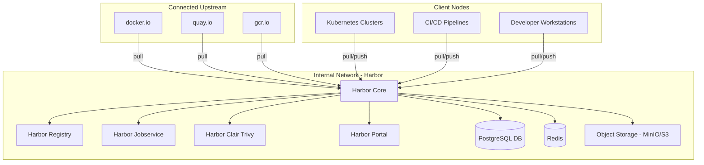
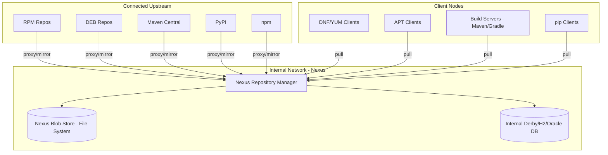
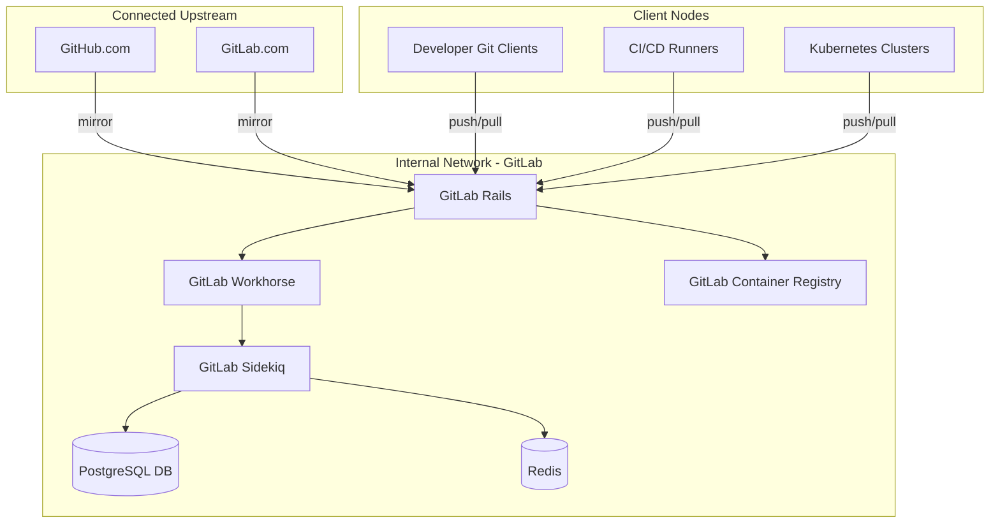

# Architecture

## Purpose and scope

Centralized software-distribution architecture: upstream/downstream repos and registries, sync/replication/promotion, controlled transfer, fully disconnected models. Each platform architecture below shows the components, data flows, and network boundaries for connected, disconnected, and air-gapped environments.

## Upstream/downstream architecture

```text
Internet (connected staging)          Internal network (downstream/air-gapped)
----------------                      ---------------------------------------
Public registries                     Harbor / Nexus / GitLab
docker.io                             ┌─────────────────────────────────┐
quay.io                               │  Harbor (OCI, Helm, charts)     │
gcr.io                                │  Nexus (RPM, DEB, Maven, PyPI)  │
github.com                            │  GitLab (Git, CI/CD packages)   │
                                      │                                 │
                                      └─────────────────────────────────┘
                                              │
                                              │ sync (skopeo, helm, rsync)
                                              ▼
                                      Air-gapped transfer station
                                              │
                                              │ physical media
                                              ▼
                                      Isolated environment
                                      Harbor/Nexus/GitLab (internal)
```

## Per-platform reference architectures

### Harbor architecture

Harbor is the primary container registry and OCI artifact store. It provides image scanning, signature verification, project-based RBAC, and replication between instances.



**Components:**

- **Harbor Core** - API, authentication, project management, replication
- **Harbor Registry** - OCI/Docker registry storage backend
- **Harbor Jobservice** - asynchronous replication, scan, garbage collection jobs
- **Harbor Clair/Trivy** - vulnerability scanning
- **Harbor Portal** - web UI
- **PostgreSQL** - metadata database
- **Redis** - caching and job queue
- **Object Storage (MinIO/S3)** - blob storage for image layers

**Network flows:**

- Upstream pull: Harbor pulls public images from docker.io, quay.io, gcr.io
- Client pull/push: Kubernetes, CI/CD, developers pull/push images via HTTPS (443)
- Internal replication: Harbor-to-Harbor replication between connected and air-gapped instances

### Nexus Repository Manager architecture

Nexus is the primary package repository for OS packages (RPM, DEB), language packages (Maven, PyPI, npm, NuGet, Cargo), and generic artifacts.



**Components:**

- **Nexus Repository Manager** - proxy, hosted, and group repositories
- **Blob Store** - file system storage for artifacts
- **Database** - metadata and component tracking

**Network flows:**

- Proxy repos: Nexus pulls from public repos on first request, caches locally
- Hosted repos: internal artifacts pushed directly
- Group repos: aggregate proxy + hosted into single URL for clients

### GitLab architecture

GitLab is the primary Git repository and CI/CD platform. It stores source code, Infrastructure-as-Code, Helm charts (via Container Registry integration), and pipeline artifacts.



**Components:**

- **GitLab Rails** - application logic, API, web UI
- **GitLab Workhorse** - reverse proxy, handles Git over HTTP, file uploads
- **GitLab Sidekiq** - background jobs (CI pipelines, imports, exports)
- **PostgreSQL** - metadata database
- **Redis** - caching and job queue
- **GitLab Container Registry** - OCI/Docker image storage (integrated with Harbor or standalone)

**Network flows:**

- Mirror: GitLab mirrors public GitHub/GitLab repos
- Git push/pull: developers and CI push/pull source code
- Container registry: build pipelines push images, Kubernetes pulls them

## Environment topology

### Connected environment

- Upstream instances have direct Internet access
- Downstream instances sync from upstream via scheduled replication
- Clients pull from downstream mirrors only

### Disconnected environment

- No direct Internet access at any level
- Upstream staging host pulls from Internet, stages to physical media
- Downstream imports from physical media via air-gapped transfer station

### Isolated environment

- Completely offline, no external connectivity whatsoever
- All artifacts pre-staged before isolation
- Updates only via physical media transfer

## Related

- [Overview (1.5 Deployment Environments)](../01-overview-and-architecture/1.5-deployment-environments.md)
- [Repository & Registry Management (3.3 Installation)](3.3-installation-config.md)
- [Shared version & compatibility matrix](../shared/matrices/version-matrix/index.md)
