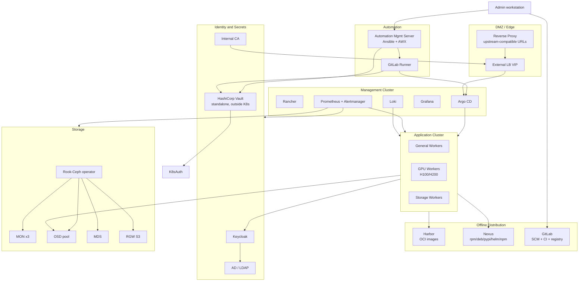

# معماری مرجع استک کلود-بومی

این سند معماری مرجع رسمی برای استک کلود-بومی را تعریف می‌کند.

## نمای کلی

معماری بر اساس مدل لایه‌بندی شده با تفکیک صریح بین płان‌های مدیریت و اپلیکیشن طراحی شده است.

## لایه‌ها

| لایه | کامپوننت‌ها | تأثیر شکست |
|---|---|---|
| فیزیکی | سرورها، PDUها، سوئیچ‌ها | از دست دادن نود؛ ذخیره‌سازی برای تحمل طراحی شده |
| توزیع آفلاین | Harbor، Nexus، میirrorهای RPM/DEB، GitLab | استقرارهای جدید مسدود؛ بارهای کاری در حال اجرا تحت تأثیر نیستند |
| اتوماسیون | سرور مدیریت اتوماسیون، Ansible، AWX، GitLab Runner | تغییرات مسدود؛ بارهای کاری تحت تأثیر نیستند |
| هویت و رازها | Keycloak، SSSD/AD، Vault، CA داخلی | ورود مسدود؛ بارهای کاری در حال اجرا باقی می‌مانند |
| ذخیره‌سازی | Ceph MON/MGR/OSD/MDS/RGW، اپراتور Rook | مسدود شدن IO PVC؛ حلقه ریستارت پاد |
| کوبرنتیز | کنترل‌پلین، etcd، CNI، CSI | زمان‌بندی/API مسدود؛ پادهای در حال اجرا IP خود را حفظ می‌کنند |
| GitOps | Argo CD، GitLab | استقرارهای جدید/تغییر یافته مسدود؛ بدون بازگشت خودکار |
| مدیریت | Rancher، Prometheus، Grafana، Loki | از دست دادن видиبیلتی؛ هیچ تأثیری روی data plane |

## تفکیک Control Plane / Data Plane

- **کلاستر مدیریت** — Rancher، Argo CD، Keycloak، Prometheus/Grafana/Loki، GitLab Runner. پул کارگر زیرساخت اختصاصی، هیچ بار کاری اپلیکیشنی.
- **کلاسترهای اپلیکیشن** — کارگرهای عمومی، کارگرهای GPU، کارگرهای مواجهه با ذخیره‌سازی. هیچ Rancher، هیچ سرور Vault، هیچ GitLab.

استدلال: `decisions/ADR-0010.md`، `decisions/ADR-0013.md`، `decisions/ADR-0025.md`.

## شبکه

| قطعه | هدف | CIDR معمولی (PROVISIONAL) |
|---|---|---|
| mgmt | SSH، Ansible، مانیتورینگ، GitLab، registry، Vault، هویت | 10.10.0.0/24 |
| control-plane | kube-apiserver، هم‌نشین etcd peer/client، کنترل CNI | 10.20.0.0/24 |
| pod | CIDR pod برای هر کلاستر (routing بومی Cilium) | 10.30.0.0/16، 10.31.0.0/16 |
| service | محدوده ClusterIP | 10.32.0.0/16، 10.33.0.0/16 |
| storage | شبکه‌های public + clusterِ Ceph | 10.40.0.0/24 + 10.41.0.0/24 |
| gpu | مدیریت کارگر GPU + بافت NVLink/PCIe | 10.50.0.0/24 |
| dmz | VIP LB خارجی، ingress، reverse proxy | 10.60.0.0/24 |
| nodeport | 30000-32767 یا پول MetalLB 10.61.0.10-10.61.0.30 | PROVISIONAL |

هر CIDR را در برابر برنامه سایت قبل از ساخت بررسی کنید. تمام پورت‌ها: `network-matrix/network-communication-matrix.md`.

## نمودار معماری منطقی (Mermaid)



## سرورهای عملیات

دو سرور اتوماسیون عملیات فراهم می‌کنند:

1. **سرور مدیریت اتوماسیون (اصلی)** — Ansible، AWX، GitLab Runner. اجرای playbookها، خط لوله CI/CD، و اتوماسیون ad-hoc.
2. **سرور Standby** — Standby داغ برای HA. Failover خودکار از طریق keepalived/VRRP.

## Load Balancerهای خارجی

دو نود در پیکربندی Active/Passive:

- **Primary** — ترمینیشن ترافیک فعال، TLS termination، WAF
- **Standby** — Standby داغ، failover خودکار از طریق VRRP/keepalived

Active/Active برای L4 load balancing استفاده نمی‌شود تا از سناریوهای split-brain جلوگیری شود. کنترلرهای L7 ingress (NGINX Gateway Fabric، Envoy Gateway) داخل کلاستر اجرا می‌شوند و توسط Argo CD مدیریت می‌شوند.

## زیرساخت ذخیره‌سازی Ceph

### Ceph Standalone (cephadm)

- **استقرار**: cephadm روی میزبان‌های ذخیره‌سازی اختصاصی
- **تاپولوژی**: ۳ MON، ۳+ میزبان OSD، ۲+ MDS برای CephFS
- **شبکه‌ها**: Public (10.40.0.0/24)، Cluster (10.41.0.0/24)
- **سرویس‌ها**: MON x3، MGR x3، pool OSD، MDS x2 برای CephFS، RGW x2 برای S3
- **دامنه شکست**: ریشه CRUSH سطح میزبان، حداقل یک OSD برای هر میزبان

### Rook-Ceph (اختیاری)

- **استقرار**: اپراتور Rook در کلاستر اپلیکیشن
- **مورد استفاده**: ذخیره‌سازی Kubernetes-native برای کلاسترهای اپلیکیشن
- **یکپارچه‌سازی**: درایورهای CSI برای RBD و CephFS
- **دامنه شکست**: مشابه standalone اما محدود به کلاستر

### دامنه‌های شکست

| دامنه | rozsاح | تحمل |
|---|---|---|
| میزبان | سرور منفرد | از دست دادن ۱ میزبان |
| راک | برق/شبکه سطح راک | از دست دادن ۱ راک |
| زون | زون دیتاسنتر | از دست دادن ۱ زون (در صورت multi-AZ) |

## کلاسترهای کوبرنتیز

### کلاستر مدیریت

- **Control Plane**: ۳ نود، etcd stacked
- **کارگران**: ۳ کارگر زیرساخت (هیچ بار کاری اپلیکیشنی)
- **کامپوننت‌ها**: Rancher، Argo CD، Keycloak، Prometheus/Grafana/Loki، GitLab Runner
- **هدف**: مدیریت پلتفرم، GitOps، هویت، observability

### کلاسترهای اپلیکیشن

- **Control Plane**: ۳ نود برای هر کلاستر، etcd stacked
- **کاربران**: General، GPU، استخرهای مواجهه با ذخیره‌سازی
- **کامپوننت‌ها**: Cilium CNI، MetalLB، NGINX Gateway Fabric، Rook-Ceph CSI، ExternalDNS، cert-manager
- **ندارد**: Rancher، سرور Vault، GitLab

## جایگیری Rancher و Argo CD

| کامپوننت | کلاستر | استدلال |
|---|---|---|
| Rancher | مدیریت | مدیریت متمرکز چند کلاستری |
| Argo CD | مدیریت | GitOps برای تمام کلاسترها (App-of-Apps) |
| Keycloak | مدیریت | هویت متمرکز |
| Vault | میزبان‌های اختصاصی | مستقل از چرخه حیات کلاستر |

## یکپارچه‌سازی ذخیره‌سازی و دامنه‌های شکست

- **یکپارچه‌سازی CSI**: درایورهای CSI Rook-Ceph در کلاسترهای اپلیکیشن
- **Ceph CSI**: RBD برای بلوکی، CephFS برای فایل‌سیستم اشتراکی
- **دامنه شکست**: کاربران ذخیره‌سازی جدا از کاربران محاسبه
- **بکاپ**: Velero + CSI snapshots برای منابع کوبرنتیز؛ snapshotهای RBD Ceph برای वालوم‌ها

## یکپارچه‌سازی هویت و Active Directory

### تأیید شده: فدراسیون هویت در لایه اپلیکیشن/پلتفرم
- **Keycloak**: ارائه‌دهنده OIDC، SAML 2.0، Kerberos — بروکر هویت مرکزی برای تمام سرویس‌های پلتفرم
- **فدراسیون کاربر LDAP/AD در Keycloak**: همگام‌سازی فقط‌خواندنی کاربر/گروه از AD/LDAP به Keycloak
- **کلاینت‌های OIDC سرویس‌ها**: Rancher، Argo CD، Harbor، GitLab، Vault از طریق OIDC Keycloak احراز هویت می‌کنند
- **AD/LDAP**: همگام‌سازی کاربر/گروه به Keycloak، تفویض Kerberos برای Keycloak

### اختیاری (نیاز به تصمیم معماری جداگانه): یکپارچه‌سازی دایرکتوری در سطح میزبان
- **SSSD/realmd**: پیوستن میزبان لینوکس به AD — *به عنوان مسیر استاندارد مجاز نیست؛ نیازمند ADR است*
- **احراز هویت مستقیم میزبان**: تنها در صورت تأیید یک ADR اختصاصی برای موارد خاص

### Break-glass (همیشه الزامی)
- حساب‌های sudo محلی روی هر نود، کلیدهای SSH آفلاین در Vault
- دسترسی اضطراری مستقل از دسترس بودن دایرکتوری

## مانیتورینگ، لاگینگ و هشداردهی

| کامپوننت | هدف |
|---|---|
| Prometheus + Alertmanager | جمع‌آوری متریک، هشداردهی |
| Grafana | داشبوردها، بصری‌سازی |
| Loki | تجمیع لاگ |
| Fluent Bit | جمع‌آوری/ارسال لاگ |
| Thanos | متریک‌های بلندمدت (اختیاری) |
| Alertmanager | مسیریابی هشدار، inhibition، silencing |

## مخازن و رجیستری‌های داخلی

| سرویس | هدف | URL داخلی |
|---|---|---|
| Harbor | ایمیج‌های OCI، چارت‌های Helm، SBOMها، امضاها | `https://harbor.internal` |
| Nexus | rpm/deb، pypi، npm، Helm، Maven | `https://nexus.internal` |
| GitLab | SCM، CI/CD، رجیستری کانتینر | `https://gitlab.internal` |
| Ceph RGW | ذخیره‌سازی شیء S3-compatible | `https://rgw.internal` |

## مرزی‌های بکاپ و بازیابی

| کامپوننت | روش | RTO | RPO |
|---|---|---|---|
| etcd | Snapshot | < ۱۵ دقیقه | ۵ دقیقه |
| Velero | بکاپ کلاستر | < ۲ ساعت | ۱ ساعت |
| Vault | Snapshot Raft | < ۳۰ دقیقه | ۵ دقیقه |
| Ceph | Snapshotهای RBD | < ۱ ساعت | ۱۵ دقیقه |
| GitLab | وظیفه بکاپ rake | < ۴ ساعت | ۱ ساعت |
| Harbor | Velero + dump DB | < ۲ ساعت | ۱ ساعت |

## تاپولوژی استقرار Air-Gapped

```
┌─────────────────────────────────────────────────────────────────────────┐
│                         محیط Air-Gap                                     │
│                                                                          │
│  ┌──────────────┐    ┌──────────────┐    ┌──────────────┐              │
│  │  Staging     │    │  Air-Gap     │    │  Production  │              │
│  │  (Connected) │───▶│  Transfer    │───▶│  (Air-Gapped)│              │
│  └──────┬───────┘    └──────┬───────┘    └──────┬───────┘              │
│        │                   │                   │                        │
│        ▼                   ▼                   ▼                        │
│  ┌─────────────────────────────────────────────────────────────────┐  │
│  │              استیج و تأیید آرتیفکت                                │  │
│  │  1. Pull از upstream                                              │  │
│  │  2. تأیید دیجست/امضا                                            │  │
│  │  3. Push به Harbor/Nexus/GitLab استیجینگ                        │  │
│  │  4. تولید artifact-matrix.md با دیجست‌ها                         │  │
│  │  5. صادرات به مدیای air-gap                                      │  │
│  └─────────────────────────────────────────────────────────────────┘  │
└─────────────────────────────────────────────────────────────────────────┘
```

## طبقه‌بندی کامپوننت‌ها

### لازم (الزامی برای Production)

| کامپوننت | هدف |
|---|---|
| Kubespray | استقرار کوبرنتیز |
| Cilium | CNI، network policy، Hubble |
| MetalLB | L4 load balancing |
| NGINX Gateway Fabric | L7 ingress، Gateway API |
| cert-manager | مدیریت گواهی‌نامه |
| ExternalDNS | اتوماسیون DNS |
| MetalLB | L4 load balancing |
| cert-manager | مدیریت گواهی‌نامه |
| ExternalDNS | اتوماسیون DNS |
| MetalLB | L4 load balancing |
| cert-manager | مدیریت گواهی‌نامه |
| ExternalDNS | اتوماسیون DNS |
| Vault | رازها، PKI |
| Keycloak | هویت OIDC/SAML |
| Rancher | مدیریت چند کلاستری |
| Argo CD | GitOps |
| Prometheus/Grafana/Loki | Observability |
| Ceph (cephadm) | ذخیره‌سازی بلوکی/فایل/شیء |
| Rook-Ceph | CSI در کلاستر |
| Velero | بکاپ/بازیابی |
| Keycloak | هویت OIDC/SAML |
| SSSD/realmd | پیوستن AD |

### اختیاری (وابسته به بار کاری)

| کامپوننت | زمانی که فعال شود |
|---|---|
| Rook-Ceph | نیاز به CSI Ceph در کلاستر |
| OpenTelemetry Operator | نیاز به tracing توزیع‌شده |
| Trivy Operator | نیاز به اسکن آسیب‌پذیری |
| Descheduler | نیاز به rebblancing pod |
| VPA | نیاز به autoscaling عمودی |
| OpenTelemetry Operator | نیاز به خط لوله tracing |
| GPU Operator | بارهای کاری GPU موجود |
| vLLM/Triton | نیاز به سرویس LLM |
| Service Mesh | نیاز به mTLS، تقسیم ترافیک |
| Kyverno/OPA Gatekeeper | نیاز به policy پیشرفته |

## تصمیمات معماری نیازمند تأیید بعدی

1. **نسخه Ceph در برابر نسخه Rook** — باید طبق یادداشت‌های انتشار Rook همخوانی داشته باشد
2. **درایور GPU در برابر CUDA در برابر Operator** — ماتریس NVIDIA باید هم‌راستا باشد
3. **چارت Vault در برابر باینری** — appVersion چارت باینری Vault را پین می‌کند
4. **نسخه Ceph Rook** — باید با نسخه Ceph در `cephVersion.image` هم‌راستا باشد
4. **ریلیز Kubespray** — باید نسخه هدف Kubernetes را پشتیبانی کند

---

*Status: DRAFT | Owner: Platform Architecture | Last reviewed: 2026-11-23*