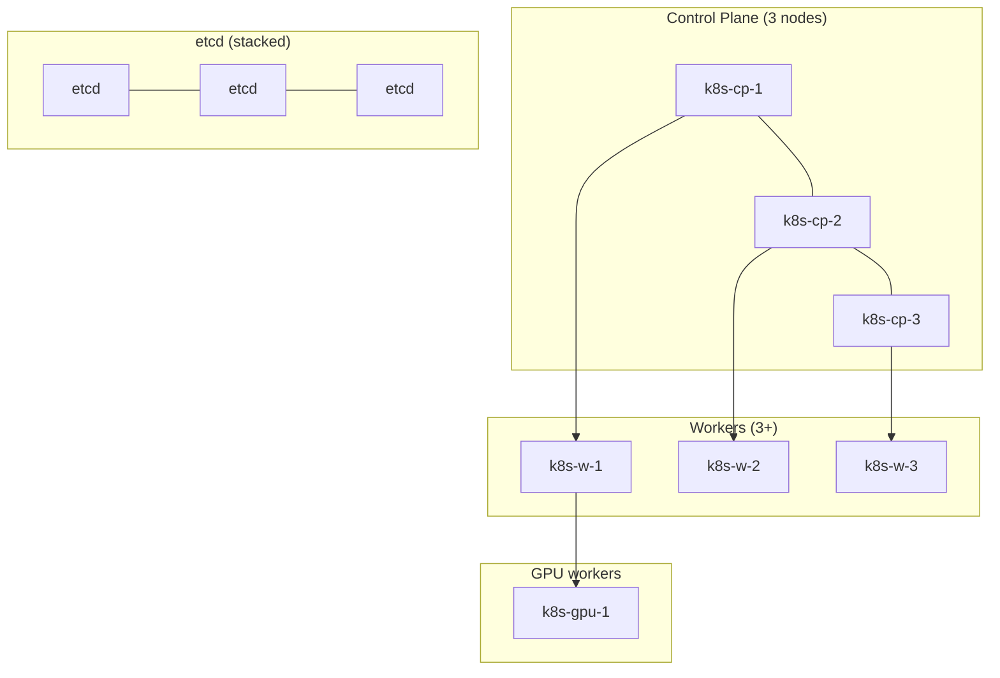

# Deployment topology diagram

## Purpose
Deployment topology showing 3-node control plane with stacked etcd, workers, and optional GPU workers.

## Related
- [Overview (1.1 Architecture)](../../01-overview-and-architecture/1.1-project-introduction-and-goals.md)
- [Kubernetes (6.1 Architecture)](../../06-kubernetes-infrastructure/6.1-kubernetes-architecture.md)
