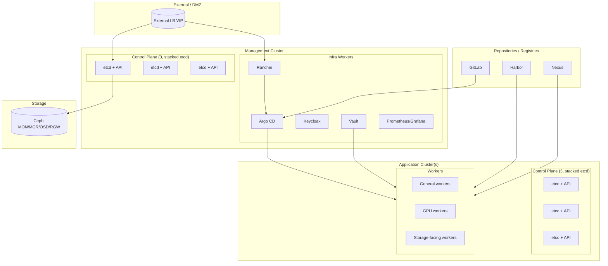

# Reference architecture diagram

## Purpose
Reference architecture showing layers: external LB, management cluster (control plane + infra workers), application clusters (control plane + workers), storage, and repositories/registries.

## Related
- [Overview (1.1 Architecture)](../../01-overview-and-architecture/1.1-project-introduction-and-goals.md)
- [Shared ADRs (ADR-0002, ADR-0006, ADR-0007, ADR-0010)](../../shared/decision-records/index.md)
