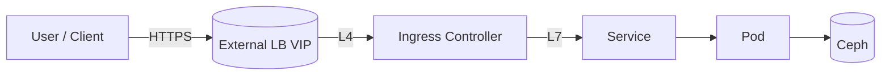

# Traffic flow diagram

## Purpose
Traffic flow from external user through load balancer and ingress to a pod and storage.

## Related
- [05 · Load Balancers (5.1 Architecture)](../../05-load-balancers/5.1-architecture.md)
- [Shared network matrix](../../shared/network-matrix/index.md)
