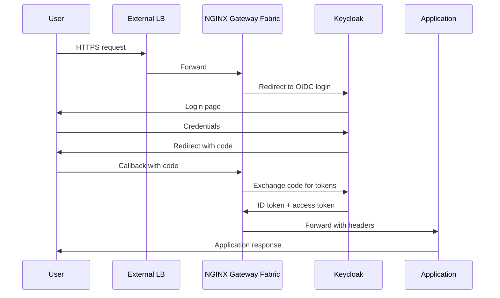

# End-User Access

This document describes how end-users access applications in the cluster.

## Overview

End-users access applications through the ingress layer. Authentication is handled by Keycloak via OIDC.

## Access Flow

## Authentication

- **OIDC Provider**: Keycloak
- **Client**: NGINX Gateway Fabric (OIDC Relying Party)
- **Scopes**: `openid profile email groups`
- **Token Validation**: JWT signature verification via Keycloak JWKS

## Authorization

- **RBAC**: Kubernetes RBAC for cluster resources
- **Application-level**: Application-specific roles mapped from Keycloak groups
- **NetworkPolicy**: Default deny, explicit allow

## Access Patterns

| Pattern | Use Case | Implementation |
|---|---|---|
| Public app | Public website | No auth, allow all |
| Internal app | Internal tools | OIDC + group-based RBAC |
| Admin app | Admin panel | OIDC + admin group |
| API | Service-to-service | mTLS + SPIFFE |

## Break-glass Access

When IdP is down:
1. Local break-glass account on cluster nodes
2. Stored in Vault, retrieved via break-glass procedure
3. Audit-logged, time-limited

---

*Status: DRAFT | Owner: Identity Team | Last reviewed: 2026-11-23*