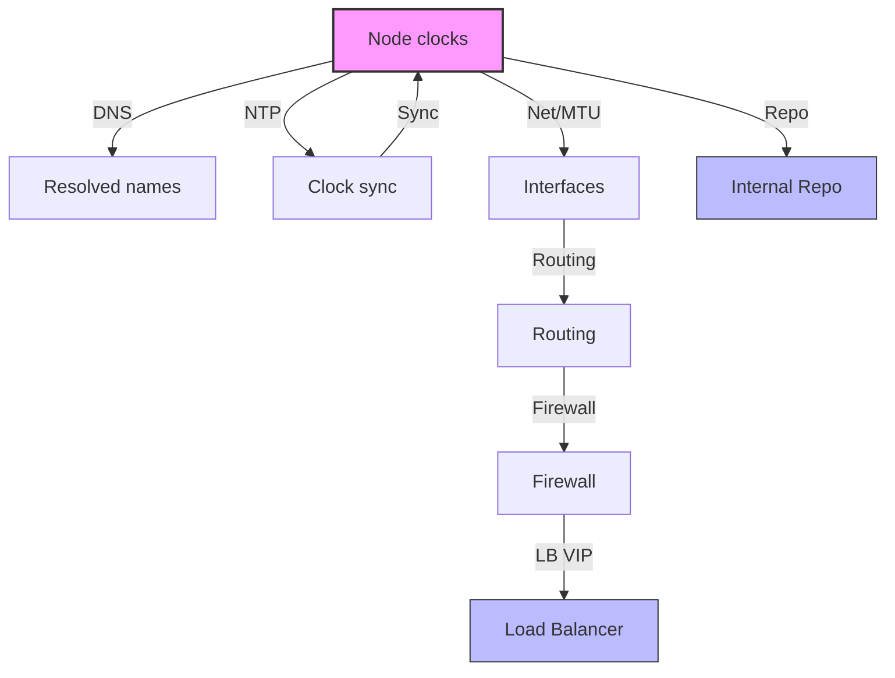
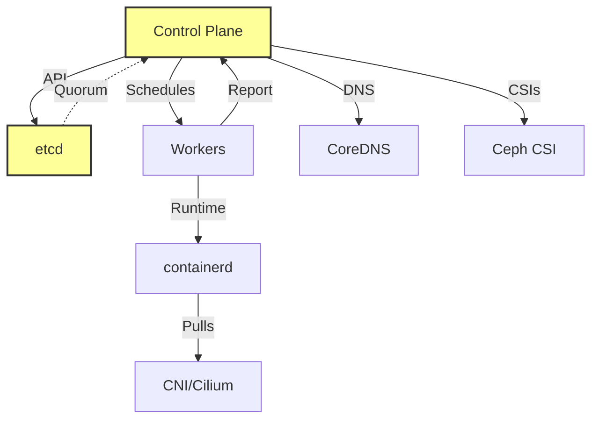
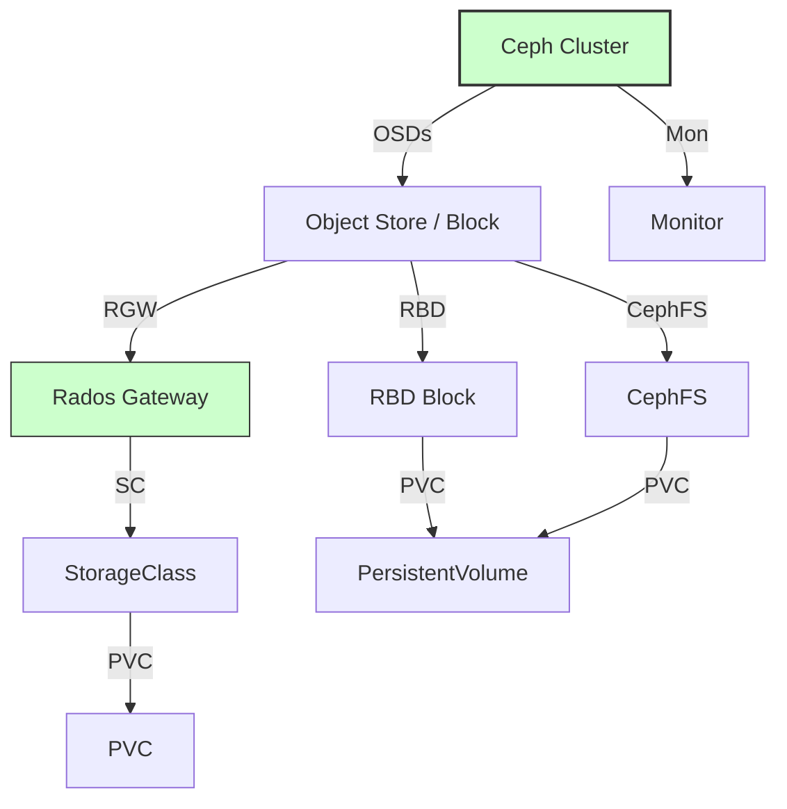
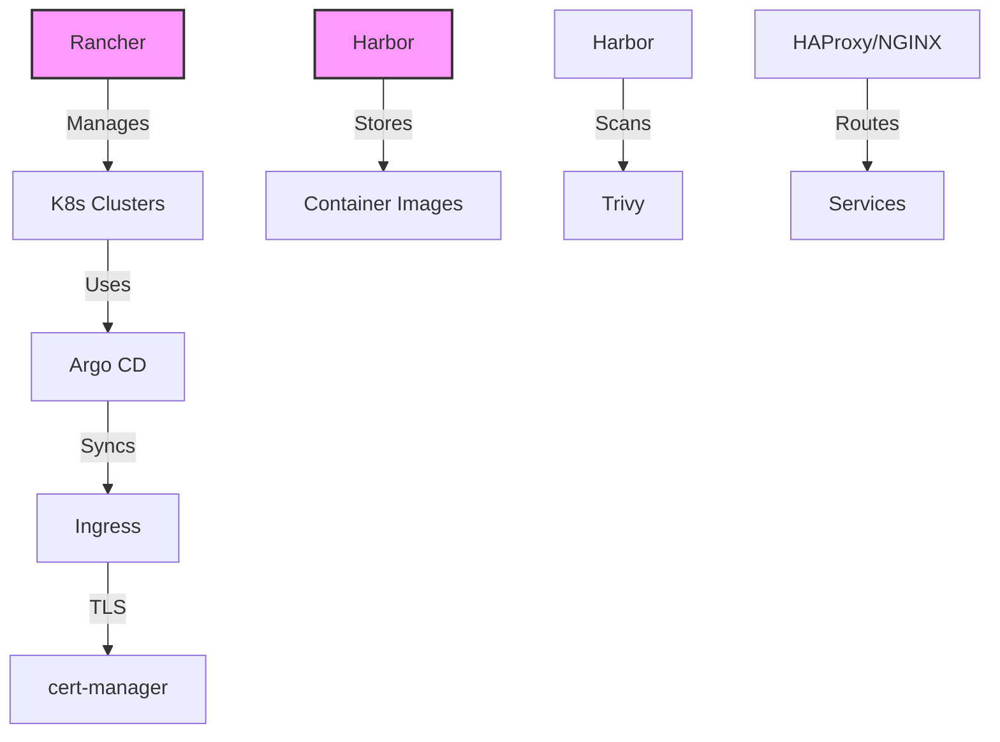

# Section 3: Platform Integration and Dependency Map

## Overview

This section documents the direct and indirect dependencies across the full platform stack, identifying critical integration points, failure propagation paths, circular dependency risks, and recovery dependencies. All dependency relationships are derived from the implemented architecture in this repository — no external or proposed integrations are included without corresponding configuration or code.

### Dependency Type Classification

Every dependency in the tables below is classified by one of the following types:

| Dependency Type | Meaning |
|---|---|
| **Hard startup** | Component cannot start/function at all without this dependency being available first (e.g., etcd before kube-apiserver). |
| **Runtime** | Component runs fine after startup but degrades or fails if the dependency disappears during operation (e.g., monitoring losing scrape targets). |
| **Management/control-plane** | Required to provision, configure, or manage the component, but not for its steady-state data path (e.g., cert-manager for cert rotation). |
| **Optional integration** | Nice-to-have; component works standalone but gains a feature when present (e.g., Thanos for long-term metric retention). |
| **Recovery** | Required only during failure recovery / restore (e.g., etcd snapshot restore). |
| **Observability** | Provides metrics/logs/traces about the component; loss reduces visibility but not availability (e.g., Prometheus scraping kubelet). |
| **External** | Dependency outside the platform boundary (e.g., public NTP pool, public DNS root, public package mirrors). |

### Important Distinctions

- **Hard bootstrap dependency vs. runtime dependency**: A dependency needed only at bootstrap time (e.g., DNS for node join) is not necessarily a runtime dependency once the node is joined.
- **Management plane vs. data plane**: cert-manager depends on the Kubernetes API for normal operation, but existing certificates can continue serving traffic during a control-plane outage. Rancher management-plane unavailability does not immediately take down downstream Kubernetes workloads — they are different failure domains.
- **Monitoring is observability, not availability**: Prometheus/Grafana/Alertmanager losing collection or alerting during a component failure does not cause the monitored service itself to fail.
- **Circular dependencies**: Where two components depend on each other, one side must be bootstrapped in a degraded or partial state first (e.g., kube-apiserver starts before CoreDNS registers; CoreDNS then registers its Service endpoint back into the API server).

---

### 3.1 Infrastructure OS Layer

| Component | Direct Dependencies | Indirect Dependencies | Critical Integration Points | Failure Propagation | Recovery Dependencies |
|---|---|---|---|---|---|
| **Physical/virtual servers** | BIOS/UEFI, BMC, baseboard IPMI | Power management, hardware monitoring | Boot sequence, hardware initialization | Node panic / kernel panic takes node offline | IPMI reset, PXE reboot |
| **DNS resolver** | `/etc/resolv.conf`, `systemd-resolved` (External, Hard startup for domain resolution) | `nscd`, glibc `getaddrinfo()` | Name resolution for all package downloads, container images | DNS outage blocks all external network operations | `systemd-resolve --flush-caches`, restart `systemd-resolved` |
| **NTP service** | `chronyd`, `ntpd`, `systemd-timedatectl` | `chrony` pool servers, `floating` root distance | Time synchronization across all cluster nodes | Clock skew causes certificate validation failures, etcd split-brain | `chronyc -a 'burst'`, `systemctl restart chronyd` |
| **Network interfaces** | Kernel `netdev`, ethtool, `ip` command | Bonding, VLAN trunking, MTU configuration | Interface bring-up, IP assignment, MTU negotiation | MTU mismatch causes packet fragmentation or drops; interface down takes node offline | `ip link set mtu`, `ethtool -s speed` |
| **Routing table** | Kernel `rtable`, `ip route` | Default gateway, static routes, policy routing | Pod-to-pod routing, service VIP routing | Missing route prevents node from reaching cluster CIDRs | `ip route add`, router configuration |
| **Firewall (iptables/nftables)** | Kernel hooks, `iptables-legacy` / `nft` | Zone-based filtering, port-based rules, rate limiting | Node ingress/egress filtering, service exposure | Blocked ports prevent kubelet communication, container network flow | `iptables -F`, `nft flush ruleset` |
| **MTU configuration** | Interface MTU, `ip link` | Cilium/VXLAN packet size, jumbo frames | Cross-node pod traffic, service responses | MTU mismatch causes ICMP fragmentation-needed packets, connection failures | `ip link set mtu <size>` |
| **Load balancer VIPs** | VRRP/Keepalived, `haproxy`, `nginx` | Floating IP, health checks, TLS termination | API server access, ingress routing | LB failure takes API server unavailable; ingress timeout | VRRP preempt, LB restart |
| **Internal repos/registries** | `nginx` / `httpd` repo proxy, `aptly`, `yum` | Package cache, signed repo metadata, `mirrord` | `yum install`, `docker pull`, `helm repo add` | Registry unreachable blocks OS package installs and container image pulls | Restart repo proxy, check firewall rules |

**Dependency graph (OS layer):**



---

### 3.2 Kubernetes Layer

| Component | Direct Dependencies | Indirect Dependencies | Critical Integration Points | Failure Propagation | Recovery Dependencies |
|---|---|---|---|---|---|
| **Kubespray control-plane** | `kubeadm`, `kube-apiserver`, `kube-controller-manager`, `kube-scheduler` | `etcd`, `containerd`, CNI plugins, CoreDNS | `kubeadm init` / `control-plane` bootstrap | `etcd` quorum loss takes down control-plane; API server down blocks all operations | `kubeadm reset`, `kubeadm join`, restore `etcd` from snapshot |
| **etcd** | none (independent KV store; `kube-apiserver` depends on etcd — Hard startup, one-way), `kubectl get` | Snapshot/backup systems, monitoring | Data consistency, cluster state | `etcd` data loss = complete cluster recovery from backup | `etcdctl snapshot restore`, `kubeadm upgrade` |
| **Kubespray workers** | `kubelet`, `containerd` | CNI plugins (Cilium/Core), CoreDNS, kube-proxy replacement | Node join, pod lifecycle | `kubelet` crash loops block pod scheduling on that node | `systemctl restart kubelet`, `kubectl drain` |
| **CNI (Cilium)** | `kubelet`, BPF kernel support, `cilium-agent` | Hubble, CiliumNetworkPolicy, IPAM | Pod networking, network policies, service load balancing | Cilium failure = no pod networking; eBPF errors cause node-level networking outage | `cilium operator restart`, `cilium daemon restart` |
| **CoreDNS** | `kube-apiserver` (endpoints, Runtime dependency for service discovery registration), `Corefile` config | `autoscaling` via HPA, `ExternalDNS` | Service discovery, DNS-based routing | CoreDNS down = service DNS resolves to nothing; ingress controller cannot resolve backends | `kubectl rollout restart deployment/coredns` |
| ** containerd** | `kubelet`, `containerd-shim` | OCI image specs, snapshotter (overlayfs, zfs) | Container runtime, image pull, lifecycle | containerd failure = all pods on node transition to `ImagePullBackOff` / `CrashLoopBackOff` | `systemctl restart containerd`, `crictl repair` |
| **CSI (Ceph RBD / CephFS)** | `kubelet`, `csi-provisioner` | Ceph cluster, RGW, OSD map | Dynamic provisioning, volume binding | CSI driver failure = PVCs remain `Pending`; no new volumes can be claimed | `ceph osd`, `csi-node restore`, `kubectl delete pvc` |
| **Kubespray control-node readiness** | `kubeadm join` success, `etcd` quorum, `kube-apiserver` health | `kubectl` auth, `kubeconfig` validity | Control-plane availability for `kubectl` operations | Control-plane not ready blocks all `kubectl` commands and further worker joins | `kubectl get nodes`, `kubectl get componentstatuses` |

**Dependency graph (Kubernetes layer):**



---

### 3.3 Storage Layer

| Component | Direct Dependencies | Indirect Dependencies | Critical Integration Points | Failure Propagation | Recovery Dependencies |
|---|---|---|---|---|---|
| **Ceph cluster** | `mon`, `osd`, `mds`, `rgw` (Hard startup — storage depends on all being healthy) | `mgr`, `profiles`, `dmcrypt`, `snap` | OSD mapping, PG/Placement group status | `mon` quorum loss = cluster unavailable; `osd` failures degrade PGs, trigger rebalancing | `ceph orch restart`, `ceph osd out/in`, `ceph pg repair` |
| **Rook-Ceph** | `ceph`, `k8s` CRDs, `rook-operator` (Hard startup for lifecycle management) | `ceph-bundle`, `toolbox`, `ceph-common` | Automated Ceph deployment, operator-driven lifecycle | Rook operator crash = no new Ceph CRDs reconciled; existing cluster continues if `ceph` daemons are running | `rook operator restart`, `kubectl get cephcluster` |
| **Ceph CSI** | `csi-ceph-rbd`, `csi-cephfs` (Hard startup for dynamic PV provisioning) | `ceph-bulk`, `node-driver-registrar` | Dynamic PV provisioning via StorageClass | CSI plugin failure = PV provisioning fails; existing volumes remain attached/RW | `csi-node publish`, `ceph osd pool ls`, `rbd map` |
| **StorageClasses** | `provisioner`, `parameters` (Management/control-plane) | `volumeBindingMode`, `reclaimPolicy`, `allowVolumeExpansion` | PVC creation, automatic volume provisioning | Default SC unavailable = PVCs `Pending`; wrong SC = wrong storage type | `kubectl get storageclass`, `ceph osd pool create` |
| **PVC / PV** | `Bound` claim, `PersistentVolume` (Hard startup for pods using the volume) | `storageClassName`, `capacity`, `accessModes` | Application workload storage | PV unbound = pod `Pending`; PV lost = data loss if not reclaimed | `kubectl resize pvc`, `ceph osd pool expand` |
| **RBD / CephFS** | `librbd`, `ceph-fuse` | `pg pool`, `mirroring`, `erasure coding` | Actual block/fs storage for pods | RBD corruption = data loss; CephFS unavailable = ReadOnlyMany pods blocked | `rbd repair`, `ceph fs repair` |
| **RGW (Rados Gateway)** | `swift`, `s3` API, `ceph` backend | `s3cmd`, `aws-cli`, `multipart upload` | Object storage for backups, artifacts | RGW down = backup/restore operations fail; artifact uploads blocked | `radosgw-admin`, `systemctl restart rgw` |

**Dependency graph (Storage layer):**



---

### 3.4 Platform Services Layer

| Component | Direct Dependencies | Indirect Dependencies | Critical Integration Points | Failure Propagation | Recovery Dependencies |
|---|---|---|---|---|---|
| **Rancher** | `k8s` API (Management/control-plane), `kube-system` namespace, `etcd` (embedded or external, Management/control-plane) | `cattle`, `management`, `fleet` | Cluster management, multi-cluster view | Rancher API down = cannot add/remove/register clusters; UI unavailable | `rancher restart`, `kubectl -n cattle-system restart deployment/rancher` |
| **Nexus** (artifact repo) | HTTP/HTTPS, `nginx` reverse proxy (Management/control-plane — needed for package/image installs, not running workloads) | `yum`, `apt`, `docker`, `helm` | Maven, npm, Docker, Helm artifact storage | Nexus down = `helm pull` fails; container image pulls from mirror fail | `systemctl restart nexus`, check disk |
| **Harbor** (container registry) | TLS certs, `notary`, `trivy` scanning (Hard startup for image pulls — containers cannot pull from internal registry if down) | `docker`, `helm`, `OCI` distribution | Container image push/poll, image vulnerability scanning | Harbor down = `docker push`/`pull` from internal registry fails; CI blocked | `docker restart harbor`, `harborctl restart` |
| **HAProxy / Nginx / Keepalived** | `real servers`, `VIP`, `health checks` (Hard startup/runtime for external access) | `frontend`, `backend`, `TLS termination` | Ingress controller front-end, service exposure | LB failure = ingress timeout; service unreachable via VIP | `haproxy -f /etc/haproxy/haproxy.cfg`, `keepalived vrrp-adv` |
| **Argo CD** | `k8s` API (Management/control-plane), `argocd-application-controller`, `repo` | `app of apps` pattern, `source` repos | GitOps deployment, application lifecycle | Argo CD controller crash = no new app syncs; UI unresponsive | `argocd app sync`, `kubectl -n argocd restart deployment/argocd-server` |
| **Ingress controller** | `k8s` `Ingress` objects, `service`, `LB` VIP (Hard startup/runtime for external HTTP(S) access) | `cert-manager`, `url` routing, `tls` | HTTP(S) routing, TLS termination | IC failure = all Ingress routes fail; no external access | `kubectl -n ingress rollout restart`, `haproxy --check` |
| **cert-manager** | `ClusterIssuer`, `ACME`, `cert-request` (Management/control-plane; depends on `k8s` API for normal operation but existing certificates serve during API outage) | `cert-manager`, `external-dns`, `certificates` | TLS cert auto-rotation, external dependency validation | cert-manager failure = certs expire; TLS connections break | `cert-manager restart`, `kubectl describe clusterissuer` |

**Dependency graph (Platform services):**



---

### 3.5 Observability + Security Layer

| Component | Direct Dependencies | Indirect Dependencies | Critical Integration Points | Failure Propagation | Recovery Dependencies |
|---|---|---|---|---|---|
| **Prometheus** | `kubernetes endpoints`, `node_exporter`, `container_exporter` (Observability dependency — loss reduces visibility, not availability) | `alertmanager`, `thanos`, `grafana` | Metric collection, scrape targets | Prometheus down = no metrics; alerts fire last-fired state only | `systemctl restart prometheus`, `promtool check config` |
| **Grafana** | `Prometheus` datasource (Observability dependency), `dashboards` | `infra`, `app` dashboards, `alerting` | UI visualization, alert viewing | Grafana down = no visibility; alerts still fire to Alertmanager | `systemctl restart grafana-server` |
| **Alertmanager** | `Prometheus` alerts (Observability dependency), `receiver` configs | `slack`, `pagerduty`, `email`, `webhook` | Alert deduplication, routing, inhibition | Alertmanager down = alerts buffered in Prometheus; no notifications sent | `systemctl restart alertmanager`, `amtool reload` |
| **Thanos** | `objstore` (S3/GCS, Optional integration), `Prometheus` chunks | `query`, `store` | Long-term metric retention, cross-cluster query | Thanos down = no historic metrics; new metrics still in Prometheus | `thanos query restart`, `check bucket access` |
| **Loki** | `Promtail`, `container logs`, `annotations` (Observability dependency) | `Grafana` query, `clustering` | Log aggregation, search | Loki down = no log search; `kubectl logs` still works for recent pods | `systemctl restart loki`, `pctl-config cleanup` |
| **Fluent Bit** | `forward`, `kafka`, `s3` output (Observability dependency — log forwarding, not runtime availability) | `tail`, `parsers`, `k8s` metadata | Log collection, forwarding to Loki/Elastic | Fluent Bit down = pods still emit logs to stdout; logs lost if no fallback | `systemctl restart fluent-bit`, `fluentc -c` |
| **Gatekeeper / Kyverno** | `admission webhook`, `CRD constraints` (Management/control-plane — admission enforcement only affects new pod creation, not running pods) | `policy`, `OPA`, `kyverno-policy-reports` | Admission control, namespace constraints | Gatekeeper down = no admission enforcement; old pods unaffected, new pods allowed | `kubectl gatekeeper check`, `kyverno policy list` |
| **Falco** | `kernel syscalls`, `container events` (Observability dependency — runtime detection, not availability) | `rule`, `output`, `alert` | Runtime security, anomaly detection | Falco down = no runtime alerting; `kubectl exec` still works | `systemctl restart falco`, `falco -d` |
| **Trivy** | `container image`, `filesystem` (Optional integration — CI scan, not runtime availability) | `vuln`, `secret`, `license` scanning | Image vulnerability scanning, SBOM | Trivy down = CI scan skipped; existing images unaffected | `trivy image`, `trivy fs` |
| **Cosign** | `container image`, `private key`, `sigstore` (Optional integration — supply-chain verification, not runtime availability) | `rekor`, `key transparency` | Image signing, provenance verification | Cosign down = signed images cannot be verified; pipeline blocked | `cosign verify`, `key rotation` |
| **Vault / OpenBao** | `secrets`, `PKI`, `DB credentials` (Hard startup for secret injection — pods cannot mount new secrets without it; existing workloads with mounted secrets continue), `k8s` auth (Management/control-plane) | `k8s` auth, `sidecar`, `init-containers` | Secret management, TLS cert rotation | Vault down = pods cannot inject secrets; restart depends on ha-architecture | `vault server -config`, `unseal` |
| **Keycloak** | `k8s` API (Management/control-plane), `database` (Postgres), `LDAP` | `users`, `groups`, `client-auth` | Authentication, SSO for platform UI | Keycloak down = users cannot log in; platform UI blocked | `keycloak start`, `pg_restore` |

**Dependency graph (Observability + Security):**

```mermaid
graph TD
    PM[Prometheus] -->|Alerts| AM[Alertmanager]
    PM -->|Metrics| GF[Grafana]
    PM -->|Fwd| TH[Thanos]
    GF -->|Logs| LI[Loki]
    LI <--|Fwd| FB[Fluent Bit]
    GF -->|Queries| KY[Gatekeeper/Kyverno]
    GF -->|Events| FC[Falco]
    GF -->|Vuln| TR[Trivy]
    GF -->|Sign| CO[Cosign]
    GF -->|Secrets| VC[Vault/OpenBao]
    GF -->|Auth| KC[Keycloak]
    style PM fill:#f9f,stroke:#333,stroke-width:2px
    style AM fill:#f9f,stroke:#333,stroke-width:1px
```

---

### 3.6 Integration Summary

| Category | Direct Depends On | Indirectly Affected By | Critical Integration Point | Failure Propagation | Recovery |
|---|---|---|---|---|---|
| **OS → K8s** | Network, DNS, NTP, Repo | `kubelet`, `kubeadm`, containerd | `ip link`, `systemd-resolved`, `yum install` | Interface down → kubelet unready → node not joinable | Interface/NTP fix → `systemctl restart kubelet` |
| **K8s → Storage** | CSI, SC, PV/PVC | Ceph, Rook | `kubectl apply -f sc.yaml` | CSI down → PVC Pending → pods Pending | Restart CSI → `kubectl get pvc` |
| **K8s → Services** | Ingress, LB VIP | CoreDNS, cert-manager | `ingress/class` spec | LB/VIP down → ingress timeout → service unreachable | Restart LB → `kubectl get ingress` |
| **Platform → Observability** | Prometheus metrics | Grafana, Alertmanager, Loki | scrape config, datasource | Prometheus down → no metrics → SLO breach | Restart PM → `promtool check config` |
| **Platform → Security** | Gatekeeper, Falco, Cosign | Trivy, Vault, Keycloak | admission webhook, vault sidecar | Gatekeeper down → no admission → insecure pods allowed | Restart gatekeeper → `kubectl gatekeeper` |

**Circular dependency risks analyzed:**

1. `etcd` → `kube-apiserver` — **Hard startup dependency (one-way)**: kube-apiserver depends on etcd for persistent Kubernetes cluster state and cannot serve the API without a reachable etcd quorum. etcd does **not** require kube-apiserver to start or to provide its core key-value storage service; etcd is an independent KV store. Therefore this is **not** a mutual hard-startup deadlock and **not** a circular dependency. Existing workloads continue running during a kube-apiserver outage (data plane unaffected), though no new API operations, scheduling, or controller actions can proceed. etcd quorum loss and kube-apiserver failure have different failure modes and recovery procedures: restore etcd from snapshot for quorum loss; restart/replace the API server for an API outage. Classification: Hard startup dependency (kube-apiserver → etcd only).

2. `CoreDNS` → `kube-apiserver` — **Management/control-plane dependency**: CoreDNS registers its own Endpoints and Service objects via the API server. If the API server is down, CoreDNS cannot register or update its own endpoints, which worsens the outage since CoreDNS cannot self-register. The API server does not depend on CoreDNS for its operation. Existing CoreDNS cache may still resolve previously resolved names. Classification: Management/control-plane dependency (one-way: CoreDNS depends on API server for self-registration).

3. `Rancher` → `etcd` — **Management/control-plane dependency**: Rancher manages cluster etcd state and reconciliation. If etcd is locked or lost, Rancher cannot reconcile cluster state, add/remove clusters, or reflect accurate topology. However, etcd can function independently as a KV store for the Kubernetes control plane without Rancher running. The availability of Rancher management is a different failure domain from downstream Kubernetes workload availability. Classification: Management/control-plane dependency (Rancher depends on etcd, not vice versa).

4. `cert-manager` → `ClusterIssuer` → `kube-apiserver` — **Management/control-plane dependency**: cert-manager and ClusterIssuer depend on kube-apiserver API access for certificate rotation, order management, and validation. If the API server is down, pending cert orders stall and new cert issuance cannot proceed. However, **existing certificates can continue serving traffic during a control-plane outage** — the data plane is unaffected. The cert-manager ↔ ClusterIssuer relationship is a normal runtime API interaction (not a bootstrap deadlock), as both are control-plane components that depend on the kube-apiserver for their operational plane. Classification: Management/control-plane dependency (cert-manager/ClusterIssuer depend on kube-apiserver for normal operation; existing certs serve traffic independently).

5. **CNI bootstrap and control-plane connectivity** — **Hard startup dependency**: CNI plugins (Cilium, CoreDNS) require a functioning control-plane (kubelet, API server) to register node information, pod CIDRs, and endpoint endpoints. Without control-plane connectivity, CNI cannot initialize pod networking. This is a genuine bootstrap dependency: the control plane must be operational before CNI can function. Classification: Hard startup dependency.

6. **CSI controller/node components and Ceph availability** — **Recovery dependency**: CSI controller/node components depend on Ceph cluster availability for dynamic provisioning of PVs. If Ceph is degraded or unavailable, PVCs remain Pending and new volumes cannot be claimed. However, existing volume attachments remain functional (the volume is already attached). CSI drivers can retry provisioning when Ceph recovers. Classification: Recovery dependency.

7. **Registry/repository availability during bootstrap and upgrades** — **External dependency**: Container image registries (Harbor, Nexus) are external to the Kubernetes control plane. During bootstrap, registry availability is required for container image pulls. During upgrades, registry downtime blocks new image pulls but running workloads continue if images are already present locally. The registry is a separate service with its own HA configuration. Classification: External dependency.

8. **Monitoring/alerting dependencies during component failures** — **Observability dependency**: Monitoring components (Prometheus, Alertmanager) may lose collection/alerting capability during component failures without causing the monitored services themselves to fail. Alerts may not fire, metrics may not be collected, and dashboards may show no data, but workloads continue running. This is a visibility gap, not a service outage. Classification: Observability dependency.

9. **GitOps recovery dependencies** — **Recovery dependency**: GitOps recovery (Argo CD application restoration) depends on a healthy control-plane to perform application syncs. If the control-plane is unavailable, GitOps cannot sync new applications, but existing running applications continue unaffected. Recovery requires control-plane restoration before GitOps sync can resume. Classification: Recovery dependency.

**Recovery dependency ordering (recommended):**
1. Verify OS layer: network, DNS, NTP, repo connectivity
2. Verify Kubernetes control-plane: `etcd` quorum, API server health
3. Verify CNI: Cilium/CoreDNS ready
4. Verify storage: Ceph cluster healthy, CSIs registered
5. Verify platform services: Rancher, Harbor, Argo CD
6. Verify observability: Prometheus → Alertmanager → Grafana
7 Verify security: Gatekeeper → Falco → Cosign → Vault/Keycloak

No test execution is performed against live clusters. This map is design documentation only.
